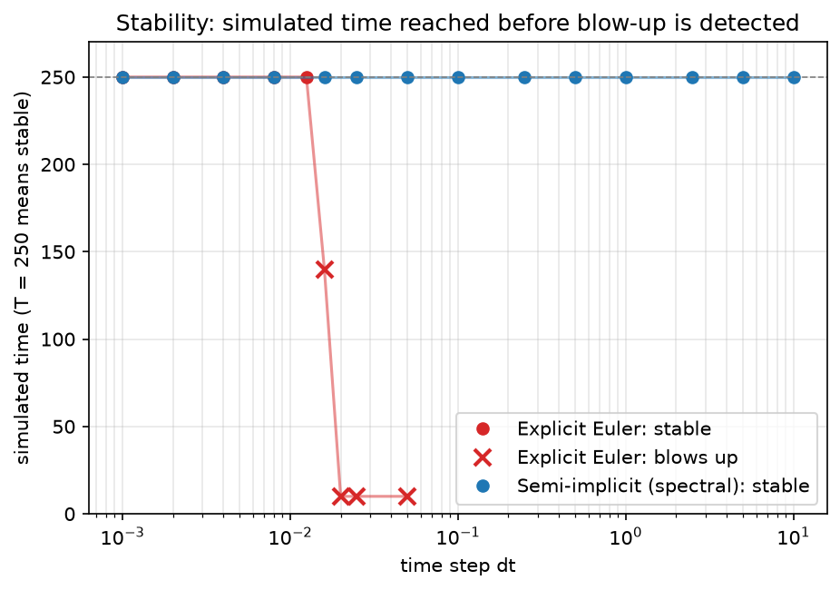
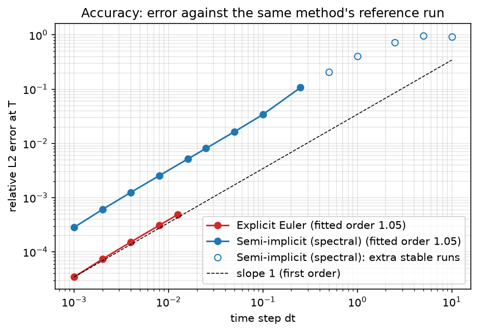
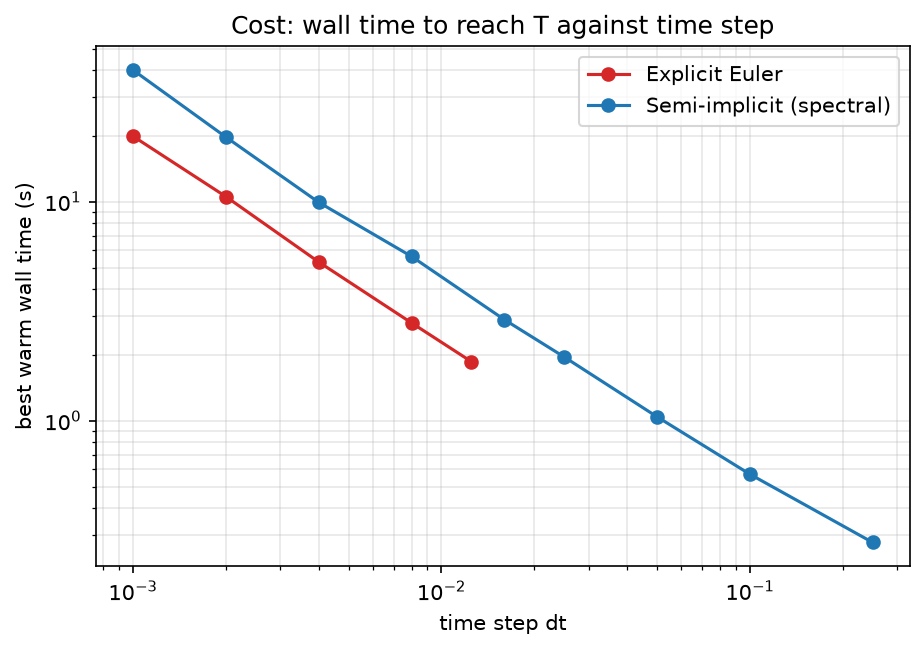
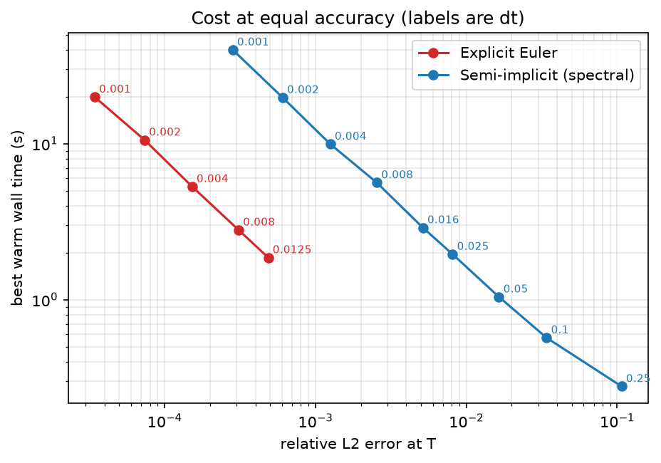

# Explicit Euler vs semi-implicit integration: stability, accuracy and cost

This project compares the two time integrators in the `pfm` phase-field code,
**explicit Euler** and the **semi-implicit spectral scheme**, on a Cahn-Hilliard
phase-separation problem using the **Landau** free energy model for a range of time steps `dt` it measures.

1. **stability**: does the simulation stay finite up to the final time?
2. **accuracy**: how far is the result from a fine-time-step reference?
3. **computational time**: how long does a run take, and what does a given accuracy cost?

**Summary of findings.**
Explicit Euler is stable up to dt = 1e-2 and blows up by dt = 1e-1
The semi-implicit scheme stayed stable up to dt = 10.
---

## 1. Problem and methods

### Problem

The conserved Cahn-Hilliard equation on a periodic 2D grid,

    d rho / dt = M * laplacian( f'(rho) - kappa * laplacian(rho) ),

with the Landau double-well free energy `f(rho) = -(epsilon/2) rho^2 + rho^4/4`.
The initial field (`Examples/landau/standard_input.dat`) is a uniform density of
0.01 with noise of about 1e-4, which is unstable and separates into two phases
(spinodal decomposition). Total mass is conserved and the free energy can only decrease.

| Parameter | Value |
|---|---|
| Grid | 64 x 64, `dx` = 1, periodic |
| Mobility `M`, gradient coefficient `k` | 1.0, 1.0 |
| `interface_scalar` | 2.0 (so `kappa` = 2; makes the reported energy consistent with the dynamics) |
| `epsilon` | 0.9 |
| Initial condition | read from `standard_input.dat` (identical for every run, no random numbers) |
| Final time `T` | 250 (the system is still coarsening at this time) |
| Precision | float64 |
| Derivatives | hand-coded (`use_autodiff = false`), forward-difference energy (`pfm_diff_method = fwd`) |

### The two integrators (as implemented in the repository)

| | Explicit Euler | Semi-implicit (spectral) |
|---|---|---|
| Time stepping | forward Euler, every term explicit | first-order implicit-explicit (IMEX) |
| Spatial derivatives | 5-point finite-difference Laplacian | Fourier spectral |
| Treatment of the stiff term `kappa * k^4` | explicit, so `dt` is limited by about `dx^4` | implicit, solved by division in Fourier space |
| Treatment of the nonlinear term `f'(rho)` | explicit | explicit |

The two schemes differ in time stepping **and** in spatial discretisation. This matters
for how accuracy is measured (section 2).

---

## 2. What was done

### Runs

Every `dt` divides `T = 250` and the 10-unit checkpoint interval exactly, so all runs
reach exactly `T` and hit the same checkpoints.

| Group | Explicit Euler `dt` | Semi-implicit `dt` | Warm repeats |
|---|---|---|---|
| Reference | 0.000125 | 0.000125 | 0 |
| Accuracy and cost sweep | 0.001, 0.002, 0.004, 0.008, 0.0125 | 0.001, 0.002, 0.004, 0.008, 0.016, 0.025, 0.05, 0.1, 0.25 | 4 |
| Stability probes | 0.016, 0.02, 0.025, 0.05 | 0.5, 1, 2.5, 5, 10 | 0 |

Each run is executed in 25 chunks of 10 simulated time units. After every chunk the
code records the free energy, the mass, `max|rho|` and whether the field is finite.

### Reference solution and error

There is no analytical solution, so the error is measured against a fine-time-step run.
The reference time step (0.000125) is at least 8 times smaller than the smallest tested `dt`.

Each method is compared against **its own** reference (self-convergence). Because the two
methods use different spatial discretisations, comparing one method against the other's
reference would include a spatial-discretisation difference that does not shrink as `dt`
goes to zero. The error therefore measures time-integration error only.

### Metrics

| Metric | Definition |
|---|---|
| Stable | the field was finite at all 25 checkpoints |
| Blow-up detected at `t` | end time of the first chunk whose field was not finite (checked every 10 time units) |
| Relative L2 error | `norm(rho - rho_ref) / norm(rho_ref)` over all grid points at `T` |
| Relative energy error | `abs(E - E_ref) / abs(E_ref)` at `T` |
| Runtime | minimum over the warm repeats of the total wall time of the 25 chunks |
| Time per step | runtime divided by the number of steps, in microseconds |
| Observed order | slope of a least-squares line through `log(error)` against `log(dt)` over the sweep points |
| Cost at equal accuracy | runtime interpolated (log-log) at a given error, within the range where both methods' errors overlap |

### Timing protocol

- The first run of each case (cold) compiles the JAX code, so its times are **not** used for cost.
- Warm repeats run the same simulation again with the code already compiled. The reported
  runtime is the minimum over 4 warm repeats, which is the least noisy estimate.
- The timer wraps only the time stepping and the wait for it to finish (`block_until_ready`).
  Energy, mass and the other diagnostics are computed outside it.
- Unstable runs and the reference runs are not timed.
- Repeated runs from the same initial field gave identical final fields.
 

### Environment
Requirement: 
`jax>=0.5.0`
`matplotlib>=3.9.3`
`numpy==2.2.4`
`toml==0.10.2`

All runs on one machine, CPU only, plugged in, no other heavy programs running.

---

## 3. Results

### Results table

One row per (method, `dt`). A dash means the value does not apply (an unstable run has no
error, and only the sweep runs were timed). The same table is in `results/results_table.csv`.

| method | dt | steps | stable | blow-up detected at t | rel. L2 error | rel. energy error | runtime (s) | us per step |
|---|---|---|---|---|---|---|---|---|
| euler | 0.001 | 250000 | yes | - | 3.438e-05 | 1.095e-05 | 19.914 | 79.7 |
| euler | 0.002 | 125000 | yes | - | 7.368e-05 | 2.347e-05 | 10.557 | 84.5 |
| euler | 0.004 | 62500 | yes | - | 1.523e-04 | 4.851e-05 | 5.307 | 84.9 |
| euler | 0.008 | 31250 | yes | - | 3.094e-04 | 9.859e-05 | 2.797 | 89.5 |
| euler | 0.0125 | 20000 | yes | - | 4.862e-04 | 1.549e-04 | 1.861 | 93.1 |
| euler | 0.016 | 15625 | no | 140 | - | - | - | - |
| euler | 0.02 | 12500 | no | 10 | - | - | - | - |
| euler | 0.025 | 10000 | no | 10 | - | - | - | - |
| euler | 0.05 | 5000 | no | 10 | - | - | - | - |
| spectral | 0.001 | 250000 | yes | - | 2.828e-04 | 4.443e-05 | 39.952 | 159.8 |
| spectral | 0.002 | 125000 | yes | - | 6.062e-04 | 9.529e-05 | 19.745 | 158.0 |
| spectral | 0.004 | 62500 | yes | - | 1.254e-03 | 1.972e-04 | 9.939 | 159.0 |
| spectral | 0.008 | 31250 | yes | - | 2.551e-03 | 4.021e-04 | 5.624 | 180.0 |
| spectral | 0.016 | 15625 | yes | - | 5.158e-03 | 8.156e-04 | 2.893 | 185.1 |
| spectral | 0.025 | 10000 | yes | - | 8.110e-03 | 1.287e-03 | 1.955 | 195.5 |
| spectral | 0.05 | 5000 | yes | - | 1.645e-02 | 2.633e-03 | 1.042 | 208.4 |
| spectral | 0.1 | 2500 | yes | - | 3.407e-02 | 5.499e-03 | 0.570 | 227.8 |
| spectral | 0.25 | 1000 | yes | - | 1.070e-01 | 1.488e-02 | 0.278 | 278.0 |
| spectral | 0.5 | 500 | yes | - | 2.081e-01 | 1.955e-02 | - | - |
| spectral | 1 | 250 | yes | - | 4.049e-01 | 2.093e-02 | - | - |
| spectral | 2.5 | 100 | yes | - | 7.324e-01 | 5.435e-02 | - | - |
| spectral | 5 | 50 | yes | - | 9.666e-01 | 1.586e-02 | - | - |
| spectral | 10 | 25 | yes | - | 9.273e-01 | 2.942e-01 | - | - |

### Stability

*Figure 1. Simulated time reached before a non-finite value was detected, against `dt`.
A value of 250 means the run was stable to the final time.*

- Explicit Euler has a hard limit. It is stable at dt = 0.0125 and blows up at 0.016 with the first non-finite value in chunk 14 (t = 140).

- The semi-implicit scheme showed no instability up to dt = 10, about 800 times the explicit  limit

### Accuracy

*Figure 2. Relative L2 error at `T` against `dt` (log-log). Filled markers are the sweep
points used for the fit; hollow markers are extra stable runs. The dashed line has slope 1.*

The semi-implicit error is about 8 times larger than the explicit one.

### Computational time

*Figure 3. Best warm wall time to reach `T`, against `dt` (log-log).*

*Figure 4. Wall time against error. Labels are `dt`. This compares the methods at equal accuracy.*

### Conclusions

On this problem (64 x 64 grid, dx = 1), explicit Euler is the better choice for any accuracy tighter than about 1%. The semi-implicit scheme is useful only for rough, cheap runs. Its advantage should grow on finer grids, because the explicit limit scales like dx^4.
---

## 4. Limitations

- **One test problem**: a single 2D Cahn-Hilliard case on a 64 x 64 grid with one initial
  condition. The explicit stability limit scales with `dx^4`, so the advantage of the
  semi-implicit scheme would be larger on finer grids. This was not tested.
- **One machine** (CPU only). Absolute times are specific to it. The ratios are more portable.
- **The reference is not exact.** For a first-order method the error at the smallest dt is
  understated by roughly `dt_ref / dt` (about 12% at dt = 0.001, less at larger dt).
  No correction was applied.
- **Stability was judged at checkpoints every 10 time units**, so short energy increases
  between checkpoints would not be seen. The measured explicit stability limit also depends on `T`:
  a marginally unstable `dt` can survive for a long time before it blows up, so a shorter `T`
  would report a larger limit. 
- **Spatial discretisation differs between the methods**, so the accuracy numbers isolate
  time-integration error and say nothing about spatial error.
- **Large-dt accuracy of the semi-implicit scheme is erratic.** The runs are stable but the
  solution is far from the reference, and the error does not always grow monotonically with `dt`.
- **Timing at very large dt is dominated by per-call overhead**, so those runs are not timed.
- The harness uses the internal method `SimulationManager._evolve_n_steps`, which is not part of
  the public interface.

---

## 5. Reproducing the results

Python 3.12 or newer, run from the repository root.

    pip install -e .

    python benchmark/test_metrics.py                    # unit tests of the metric functions
    python benchmark/run_experiments.py probes          # stability probes (under a minute)
    python benchmark/run_experiments.py reference       # two reference runs
    python benchmark/run_experiments.py sweep           # timed sweep, leave the machine idle
    python benchmark/analyze.py                         # table and figures

Finished cases are saved and skipped on re-runs, so an interrupted run can be resumed.

### Files

| File | Purpose |
|---|---|
| `benchmark/harness.py` | builds a simulation for a method and `dt`, and runs it in 10-unit chunks recording diagnostics and timings |
| `benchmark/experiment.py` | runs one (method, `dt`) case, saves it to `results/raw/`, and loads it back |
| `benchmark/metrics.py` | stability, error, order-of-accuracy, mass and cost functions |
| `benchmark/test_metrics.py` | tests for `metrics.py` |
| `benchmark/run_experiments.py` | the list of cases and the command-line launcher |
| `benchmark/analyze.py` | builds the table and the four figures from the saved cases |
| `benchmark/results/raw/` | one `.npz` file per case (final field, energy, mass, finite flags, timings) |
| `benchmark/results/` | `results_table.csv`, `results_table.md`, `fig1` to `fig4` |

